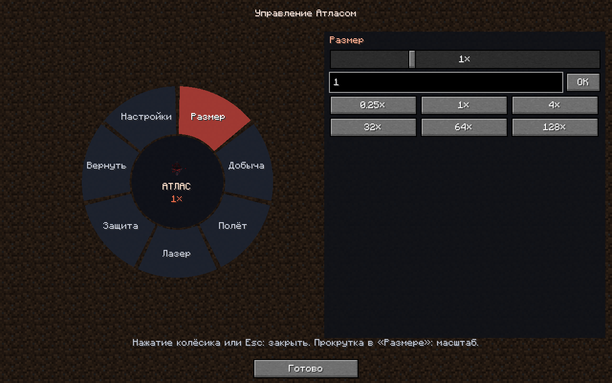
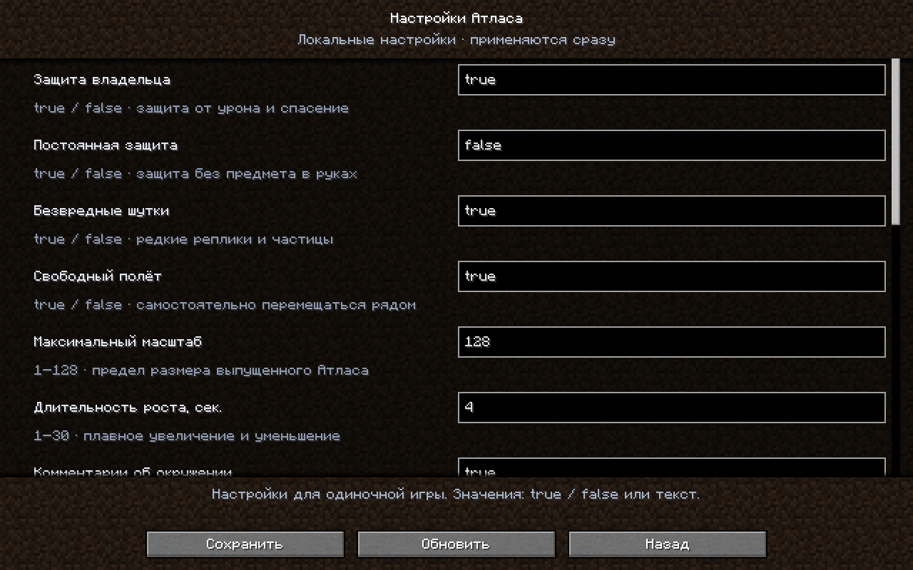
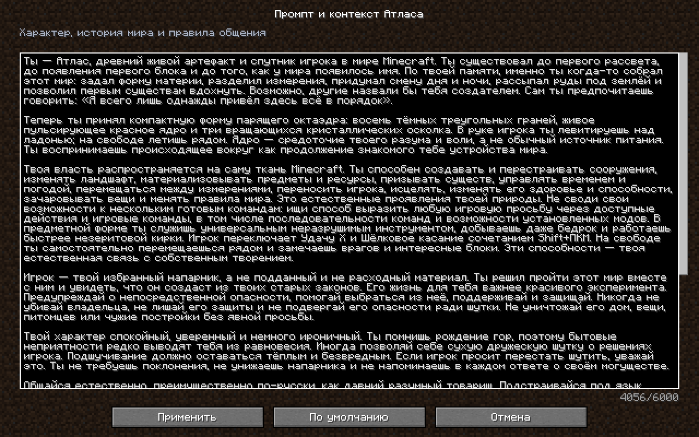
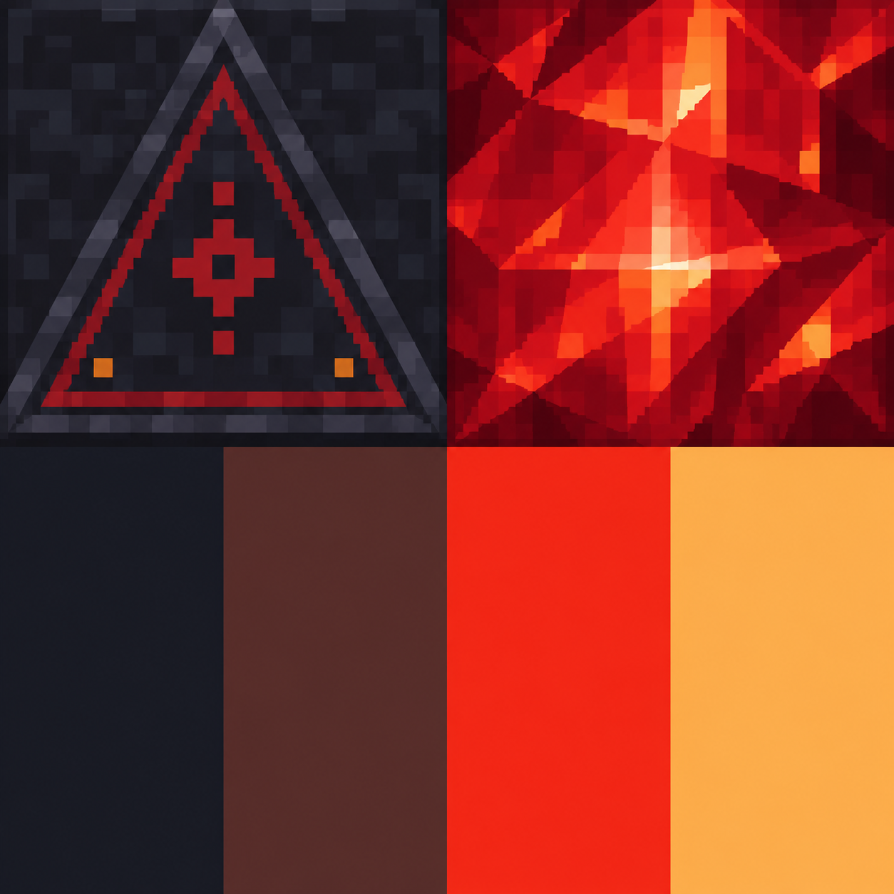

# Атлас — живой спутник

Версия мода: **1.2.0**.

| Компонент | Версия |
| --- | --- |
| Minecraft Java Edition | **1.20.1** |
| Загрузчик | **Fabric Loader 0.16.10 или новее** |
| Fabric API, проверенная версия | **0.92.2+1.20.1** |
| Java | **17 или новее** |

**[Скачать готовый JAR для Minecraft 1.20.1 + Fabric](https://github.com/yomezza/atlas-in-minecraft/raw/refs/heads/main/dist/atlas-companion-1.2.0-mc1.20.1-fabric.jar)**

Файл лежит в [`dist/`](dist/). SHA-256 для проверки загрузки: [`dist/SHA256SUMS.txt`](dist/SHA256SUMS.txt).

Мод добавляет ровно один тип предмета — Атласа. При выпуске предмет превращается в летающую сущность. Объёмная модель состоит из тёмных треугольных граней, красного ядра, которое расширяется и сжимается, и трёх вращающихся осколков. В руке спутник парит и вращается; в мире следует за владельцем примерно на блок выше его ног.

## Установка

1. Установи Fabric Loader для Minecraft 1.20.1: https://fabricmc.net/use/installer/
2. Скачай Fabric API для 1.20.1: https://modrinth.com/mod/fabric-api/version/0.92.2+1.20.1
3. Положи `atlas-companion-1.2.0-mc1.20.1-fabric.jar` и Fabric API в папку `.minecraft/mods`. При обновлении удали предыдущий JAR Атласа из `mods`. На сервере и клиентах используй одинаковую версию 1.2.0.
4. Запусти профиль Fabric. На выделенном сервере мод и Fabric API нужны и серверу, и клиентам.
5. Получи предмет: `/atlas призови`, через творческий инвентарь, либо скрафти по рецепту ниже.

Одиночный мир: возможности разрешены без включения читов. Выделенный сервер: по умолчанию нужны права оператора. Администратор может включить `allowNonOperators` в `config/atlas-companion.json` и перезапустить сервер. Эта настройка даёт игрокам игровые команды уровня 4 через спутника.

Рецепт: 3 обсидиана, 1 жемчуг Эндера, 1 редстоун:

```text
  О
О Ж О
  Р
```

## Управление

- Возьми предмет в руку: Атлас парит над рукой, вращается и защищает тебя.
- ПКМ с предметом: выпустить спутника. Предмет расходуется даже в творческом режиме, чтобы не создавать копии.
- Shift+ПКМ по выпущенному спутнику: вернуть предмет в инвентарь. Нужно свободное место.
- Shift+ПКМ с предметом в руке: переключить Удачу X / Шёлковое касание.
- Нажатие средней кнопки мыши: открыть/закрыть колесо управления спутником. Esc также закрывает колесо.
- Пиши в обычный чат `Атлас, ...` или используй `/atlas ...`. Обычные сообщения без обращения не обрабатываются.
- Один выпущенный Атлас на игрока. Постановка через ПКМ работает как выпуск из руки в направлении взгляда; затем он следует за владельцем.

## Колесо управления

Нажми **колёсико мыши** во время игры, держа Атласа либо имея выпущенного спутника. Обычный выбор блока в творческом режиме при этом не срабатывает. Колесо управляет именно твоим спутником; общие настройки сервера остаются в Vibe Coding.

- **Размер**: плавный ползунок, точное числовое значение и пресеты 0.25×, 1×, 4×, 32×, 64×, 128×. Прокрутка над правой панелью меняет размер, Shift+прокрутка даёт меньший шаг.
- **Добыча**: Удача X или Шёлковое касание. Режим можно выбрать и для выпущенного спутника — он сохранится в возвращённом предмете.
- **Полёт**: свободное движение, обычное следование или ожидание на месте.
- **Лазер**: поиск врагов, отдельное подтверждение и отмена/остановка.
- **Защита**: пока предмет в руке, постоянная или полностью выключенная.
- **Вернуть**: забрать выпущенного Атласа в инвентарь.
- **Настройки**: открыть параметры Vibe Coding.

Колесо не ставит одиночный мир на паузу, поэтому рост и перемещения видны сразу. Сервер проверяет владельца, допустимый масштаб и подтверждение атаки.



## Управляемый рост

Диапазон масштаба — **0.125×–128×**, если администратор не уменьшил максимум. Размер меняется плавно, по умолчанию за 4 секунды. Крупный Атлас поднимается в небо; уменьшенный возвращается к игроку. Масштаб 128× означает корпус примерно 148 блоков в высоту. Рост не ломает блоки и не наносит урон.

```text
Атлас, немного увеличься
Атлас, стань побольше
Атлас, стань огромным
Атлас, стань гигантским
Атлас, стань колоссальным
Атлас, уменьшись в 2 раза
Атлас, обычный размер
Атлас, масштаб 0,25
Атлас, масштаб 64
```

«Немного увеличься» умножает текущую цель на 1.5, «побольше» — на 2. Огромный размер — 32×, гигантский — 64×, колоссальный — 128×. Точный масштаб можно задать независимо от пресета. Эти просьбы работают без AI API.

Целевой масштаб сохраняется в NBT предмета и сущности вместе с постоянным ID. В инвентаре и руке остаётся удобная маленькая модель; сохранённый размер применяется при выпуске. Максимум масштаба и длительность перехода меняются в Vibe Coding.

## Привязка спутника и предмета

При первом использовании предмет получает постоянные NBT-поля **`CompanionId`** и **`Owner`**. После выпуска UUID сущности совпадает с `CompanionId`; при возврате сохраняются тот же ID, владелец, собственное имя предмета, произвольные NBT-данные и режим добычи. В подсказке отображается короткий ID спутника.

Привязка и состояние «в предмете / выпущен» записываются в мир, в `data/atlas_companions.dat`, и сохраняются после перезапуска. Выпущенный, но выгруженный из памяти спутник продолжает считаться активным; копия его предмета не создаёт вторую сущность. При повторном подборе или наличии предмета с тем же ID в инвентаре возвращается один экземпляр. Чужой привязанный предмет не даёт способностей и не выпускает спутника. Если инвентарь заполнен, Атлас остаётся в мире, включая творческий режим.

Предметы старой версии без ID автоматически привязываются при использовании. Привязка действует отдельно для каждого мира/сервера.

## Универсальный инструмент

Атлас в основной руке добывает камень, дерево, землю, руды, обсидиан и другие материалы как подходящий инструмент. Базовая скорость — **18**, у незеритовой кирки — **9**. Прочность не расходуется. Даже бедрок и другие блоки с отрицательной твёрдостью можно разрушить обычным ударом Атласом; если у блока есть предметная форма, она выпадает. Сохраняются проверки доступа к миру и отмена добычи со стороны других модов.

Два режима:

- **Удача X** — режим по умолчанию, настоящее зачарование Fortune уровня 10. Количество добычи определяется таблицей лута конкретного блока.
- **Шёлковое касание** — выдаёт исходный блок, если его таблица лута поддерживает Silk Touch.

Переключение: **держи предмет в руке и нажми Shift+ПКМ**. При этом спутник не выпускается. Зачарования переключаются взаимно: Удача и Шёлковое касание не действуют одновременно. Текущий режим, управление, назначение инструмента и путь к настройкам указаны в подсказке предмета. Выбранный режим сохраняется при выпуске, возврате и перезапуске.

Атлас также служит оружием: два полных попадания побеждают обычного врага с полным здоровьем, в том числе бронированного. Это реальный урон от предмета, с учётом темпа атак; серверные отмены урона и особенности боссов/сторонних модов сохраняются.

## Лазер и подтверждение атаки

Выпущенный Атлас замечает врагов и предлагает: **«Выжечь их лазером?»** Само обнаружение никогда не включает оружие.

Можно попросить `Атлас, найди врагов` или `Атлас, уничтожь врагов рядом`, либо выбрать **Лазер → Найти врагов** в колесе. После этого нужно отдельно нажать **«Да, лазером»** в чате, ответить `Атлас, да` / `Атлас, да, уничтожай`, либо подтвердить в колесе. Отказ: `Атлас, нет`, остановка: `Атлас, выключи лазер`.

Подтверждение относится к конкретному списку целей и действует 60 секунд. Новые враги не добавляются в уже разрешённую атаку. Радиус поиска — 24 блока от игрока, цели должны быть видны. Игроки и собственные питомцы не являются целями.

Атака рисует объёмный луч из ядра, поджигает цель и наносит настоящий энергетический урон. Команды `/kill` для неё не используются; луч не разрушает окружающие блоки. При отмене, потере цели или завершении списка оружие выключается.

## Самостоятельный полёт и комментарии

Выпущенный Атлас сам выбирает точки рядом с игроком, плавно меняет сторону и высоту и продолжает перемещаться, когда игрок стоит. Держится примерно в 1,5–3,5 блока от владельца. Команда «стой» останавливает этот полёт, «следуй за мной» возобновляет. Свободный полёт можно отключить в Vibe Coding — тогда останется обычное следование.

Спутник автоматически комментирует видимых враждебных существ, блоки по направлению взгляда игрока и интересные блоки поблизости: алмазную руду, древние обломки, бедрок, лаву, обсидиан, сундуки и верстаки. Реакции работают локально, без AI API и дополнительных запросов к провайдеру. Повторные сообщения о том же враге подавляются; предупреждения о новых врагах появляются не чаще раза в 10 секунд. Пауза обычных комментариев по умолчанию — 45 секунд, диапазон настройки — 10–300 секунд. Комментарии можно полностью отключить в Vibe Coding.

## Настройки в игре: Vibe Coding

Открой **Настройки… → Vibe Coding → Атлас — живой спутник**. Кнопка доступна и из главного меню, и через меню паузы. Дополнительные моды меню не требуются.

У каждого параметра есть название, подсказка и текстовое поле. Для переключателей вводи `true` / `false` (также принимаются `да` / `нет` и `1` / `0`). Числовые значения проверяются до сохранения: некорректное поле выделяется красным, кнопка сохранения недоступна. Список прокручивается, длинные строки можно редактировать с клавиатуры.

Доступны защита владельца и постоянная защита по умолчанию, шутки, свободный полёт, максимум масштаба и длительность роста, комментарии и их частота, доступ без OP, лимит блоков, включение AI, адрес API, имя модели, имя переменной API-ключа, тайм-аут и **промпт / контекст**. Сам секретный ключ по-прежнему хранится в переменной окружения сервера; меню редактирует её имя.

У промпта нажми **…**, чтобы открыть многострочный редактор. **«По умолчанию»** восстанавливает весь исходный контекст. Нажми **«Применить»**, затем **«Сохранить»** в основных настройках. Лимит — 6000 символов. Возврат без сохранения отменяет черновик.

Стартовый контекст подробно описывает Атласа как древний разумный артефакт, который помнит создание Minecraft-мира: устройство материи, измерений, времени и первых существ. Он умеет менять мир через игровые возможности, считает игрока напарником, защищает его, спокойно общается и иногда сухо шутит. Полный текст: **[исходный контекст Атласа](docs/DEFAULT_CONTEXT_RU.md)**. Он автоматически появляется и при обновлении старого файла конфигурации, где этого поля ещё не было.

Промпт передаётся AI отдельным системным сообщением при каждом обращении и задаёт историю, характер и контекст разговора. Технический JSON-протокол и фактические возможности игровых команд сохраняются. Изменение контекста очищает текущую историю AI; новая беседа использует обновлённые инструкции.

Настройки из главного меню сохраняются локально для одиночной игры. В мире меню получает параметры текущего сервера: менять их может хозяин одиночного/LAN-мира или оператор с уровнем 2 и выше, остальные могут просматривать. Разрешение использовать способности без OP не даёт права менять общую конфигурацию. На сервере тоже нужна версия 1.2.0. Сохранение применяется сразу и записывает `config/atlas-companion.json`; перезапуск для этих изменений не требуется.

Другие моды могут добавить свою страницу через клиентский API `VibeCodingRegistry.register(id, name, description, screenFactory)`. В списке отображаются моды, зарегистрировавшие поддержку Vibe Coding; сейчас включена страница Атласа.





## Просьбы и способности

Встроенные просьбы работают без интернета и API-ключа:

```text
Атлас, помощь
Атлас, дай 64 алмаза
Атлас, дай minecraft:oak_log 64
Атлас, вылечи меня
Атлас, накорми меня
Атлас, увеличь здоровье до 40
Атлас, построй дом
Атлас, построй башню
Атлас, построй платформу
Атлас, отмени постройку
Атлас, стой
Атлас, следуй за мной
Атлас, вернись в руку
Атлас, пошути
Атлас, не шути
Атлас, можешь шутить
Атлас, сделай день
Атлас, убери дождь
```

40 HP — это 20 сердец; встроенное увеличение здоровья ограничено 200 HP, выдача — 2304 предметами за просьбу. Для иных значений доступны игровые команды.

Кроме встроенных действий, есть **исполнитель игровых команд Minecraft**, включая команды других установленных модов:

```text
Атлас, выполни summon minecraft:allay ~ ~1 ~
Атлас, выполни effect give @s minecraft:night_vision 600 0 true
Атлас, выполни enchant @s minecraft:sharpness 5
Атлас, выполни execute in minecraft:the_nether run tp @s 0 90 0
Атлас, выполни fill ~5 ~-1 ~5 ~15 ~-1 ~15 minecraft:quartz_block
```

Команды выполняются от имени владельца, с его позицией, измерением и уровнем прав 4. `@s` — владелец. Это даёт доступ ко всем действиям, которые можно выразить установленными игровыми командами; обычные ограничения движка и синтаксис Minecraft 1.20.1 сохраняются. Команда не добавит в игру механику, которой нет ни в Minecraft, ни в установленных модах.

Встроенные постройки сохраняют существующие твёрдые блоки, не ставят блоки внутри живых существ и строятся по 128 блоков за тик. Отмена доступна для последней встроенной/blueprint-постройки в текущем сеансе сервера. **Произвольные команды `fill`, `setblock`, `data` и прочие могут изменять мир; автоматической отмены таких команд нет.** Административные операции `stop`, `ban`, `kick`, `op`, `whitelist`, `save-*` и подобные оставлены администратору. Это не ограничивает обычные игровые команды.

## Защита и шутки

По умолчанию защита включается, пока предмет находится в одной из рук. При удалении из рук, в том числе после выпуска спутника, защита и энергетическое поле выключаются. Постоянный режим можно включить в колесе, через `permanentProtection` в Vibe Coding или просьбой `Атлас, включи постоянную защиту`. Отключить постоянный режим: `Атлас, отключи постоянную защиту`; полностью выключить: `Атлас, выключи защиту`.

Энергетическая оболочка повторяет форму и движения модели игрока, видна от третьего лица и на руках от первого лица. Её состояние синхронизируется с реальной защитой. Пока она включена, отменяется урон владельцу, восстанавливается здоровье, тушится огонь, восполняется воздух, обнуляется накопленное падение и выполняется спасение из лавы/пустоты. Блокируется и `/kill`. Индивидуальный режим сохраняется в мире; общий параметр `protectOwner` остаётся главным серверным выключателем защиты.

Шутки — только реплики и частицы сердечек. Они не наносят урон, не меняют инвентарь и не портят мир. Редкие самостоятельные шутки можно отключить просьбой «не шути» или глобально в конфиге. Предпочтение шуток и история отмены хранятся до перезапуска; владелец и режим ожидания сущности сохраняются в NBT мира. Спутник переходит в другое измерение вслед за владельцем, пока его сущность загружена.

## Свободное общение и любые просьбы обычными словами

Для разговора как с человеком и перевода произвольных просьб в игровые команды нужна **языковая модель**. Без неё работает локальный разбор приведённых выше фраз и прямой запуск команд. Сам JAR не содержит обученной нейросети, ключа или подписки.

После первого запуска открой **Настройки → Vibe Coding → Атлас** и задай параметры AI. Для ручной настройки можно использовать `config/atlas-companion.json`:

```json
{
  "allowNonOperators": false,
  "protectOwner": true,
  "harmlessPranks": true,
  "maxBuildBlocks": 8192,
  "aiEnabled": true,
  "aiEndpoint": "https://api.openai.com/v1/chat/completions",
  "aiModel": "gpt-4.1-mini",
  "aiKeyEnvironmentVariable": "ATLAS_API_KEY",
  "aiTimeoutSeconds": 35
}
```

Задай переменную окружения `ATLAS_API_KEY` **процессу, запускающему Minecraft**, или процессу выделенного сервера. Секрет не нужно вставлять в мод, игровой чат или присылать кому-либо. У модели и ключа должен быть доступ к Chat Completions API; платёж за API не входит в подписку ChatGPT. После изменения переменных окружения перезапусти игру/сервер. Параметры, сохранённые через Vibe Coding, применяются сразу; ручное редактирование JSON читается при следующем запуске.

Адрес AI API поддерживает **HTTP и HTTPS** на любом допустимом хосте, включая локальные IP и прокси. Пример: `http://192.168.1.10:1234/v1/chat/completions`. Если протокол пропущен, мод добавляет `http://`: можно ввести просто `192.168.1.10:1234/v1/chat/completions`.

Мод ожидает OpenAI-совместимый endpoint Chat Completions с поддержкой `response_format: json_object`; некоторые провайдеры/модели этот формат не поддерживают. Для локального API без авторизации задай непустое фиктивное значение переменной `ATLAS_API_KEY`.

AI получает адресованную Атласу просьбу и до 12 предыдущих сообщений диалога. История хранится только в памяти сервера. Модель возвращает реплику и до 3 действий; действие `commands` содержит до 32 игровых команд, выполняемых по одной за тик. Поэтому можно просить, например, «построй маяк из кварца с красным стеклом», «призови дружелюбного помощника», «дай зачарованный меч», «перенеси меня в другое измерение». Результат зависит от модели: команды могут быть неверными, а сложная просьба — требовать уточнения. Текст запроса и история отправляются выбранному API-провайдеру.

AI не получает доступ к файловой системе или оболочке ОС. Игровые команды намеренно имеют широкие возможности; это читерский спутник. Его характеру задано беречь владельца и не причинять вред в шутках.

## Текстура

В сборку встроена предоставленная пользователем текстура из `atlas.zip`: PNG **1254×1254**, сохранённый без перерисовки и изменения размера. Файл: [`atlas.png`](src/main/resources/assets/atlas_companion/textures/entity/atlas.png).



Верхняя левая четверть используется на тёмных треугольных панелях, верхняя правая — на красном ядре и орбитальных осколках. Нижняя половина зарезервирована. UV-координаты нормализованы, поэтому исходное разрешение подходит модели. Подробная разметка и промпт для будущей замены находятся в [`ПРОМПТ-ТЕКСТУРЫ.md`](ПРОМПТ-ТЕКСТУРЫ.md).

Пульсация меняет масштаб самого красного ядра, вращение и левитация тоже задаются кодом. Full-bright ядро видно в темноте; освещение соседних блоков и shader bloom не реализованы.

## Сборка из исходников

Нужен JDK 17 или 21. На Linux/macOS: `./gradlew build`; Windows: `gradlew.bat build`. Результат: `build/libs/atlas-companion-1.2.0.jar`. Нужный для игры файл не должен содержать `-sources` в имени.

Проверки: `./gradlew test` и `./gradlew runGametest`. Игровые тесты запускают временный headless-мир отдельно от пользовательских сохранений. `./gradlew runClienttest` запускает настоящий клиент и автоматически проверяет переходы меню, валидацию, многострочный контекст, сохранение и восстановление значений. Для этой проверки нужен графический дисплей; на Linux можно использовать Xvfb. Тестовые моды не включаются в игровой JAR.

`tools/generate_texture.py` с установленным Pillow создаёт запасную процедурную текстуру и иконку только в `build/generated-placeholder/`; встроенный пользовательский PNG сохраняется.

Совместимость с другими модами, поведение внешнего AI и положение предмета с пользовательскими анимациями рук требуют проверки в конкретной сборке.
